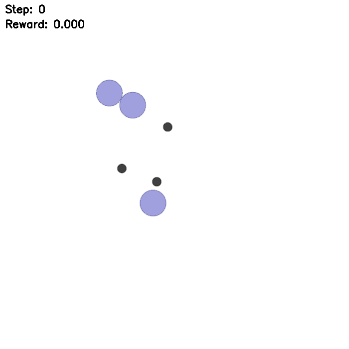
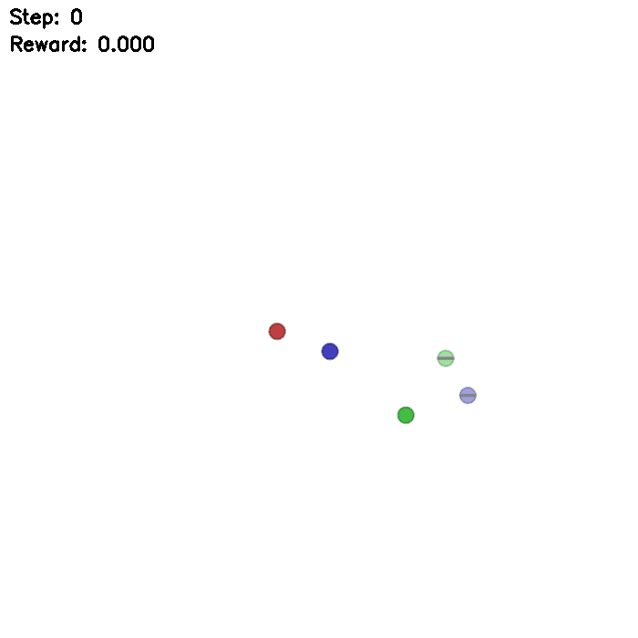

# FeudalMultiAgent

**A Hierarchical Manager–Worker Framework for Cooperative Multi-Agent Reinforcement Learning**

[English](#english) | [中文](#中文)

---

# English

## Introduction

**FeudalMultiAgent** is a research implementation of hierarchical cooperative multi-agent reinforcement learning.

The framework uses a high-level **Manager** to generate latent goals and a low-level **Worker** to select actions according to local observations and the generated goals. The training procedure combines hierarchical reinforcement learning with PPO/MAPPO-style policy updates.

This repository is developed for experiments on cooperative multi-agent tasks and is based partly on the open-source MAPPO/on-policy implementation.

## Main Features

* Hierarchical Manager–Worker policy
* Recurrent neural networks for temporal information
* Goal-based intrinsic rewards
* PPO/MAPPO-style repeated policy updates
* Shared policy parameters among agents
* TensorBoard logging and model evaluation
* Support for Discrete and MultiDiscrete action spaces

## Supported Environments

| Environment           | Agents | Description                                         |
| --------------------- | -----: | --------------------------------------------------- |
| `simple_spread_v3`    |      3 | Agents cooperate to cover multiple landmarks        |
| `simple_reference_v3` |      2 | Agents cooperate through movement and communication |

## Experimental Results

### Simple Spread



### Simple Reference



## Installation

Clone the repository:

```bash
git clone https://github.com/fatgreen/FeudalMultiAgent.git
cd FeudalMultiAgent
```

Create a Python environment:

Install PyTorch according to your operating system and CUDA version, then install the remaining dependencies:

```bash
pip install -r requirement.txt
pip install -e .
pip install seaborn
pip install pyglet==1.5.27
```

## Training

Train on Simple Reference:

```bash
python train_mappo.py --env_name simple_reference_v3
```

Train on Simple Spread:

```bash
python train_mappo.py --env_name simple_spread_v3
```

The main experiment settings can be modified in `config.py` or passed through command-line arguments.

## Evaluation

Models are loaded from:

```text
models/<environment>/<model_name>.pt
```

Example:

```bash
python evaluate.py --env_name simple_reference_v3 --load_model <model_name>
```

Rendered evaluation results are saved under:

```text
records/<environment>/
```

## TensorBoard

```bash
tensorboard --logdir logs/train/<environment>
```

## Acknowledgements

This project is inspired by:

* FeUdal Networks for Hierarchical Reinforcement Learning
* The Surprising Effectiveness of PPO in Cooperative Multi-Agent Games
* The `marlbenchmark/on-policy` repository
* Multi-Agent Particle Environments

---

# 中文

## 專案介紹

**FeudalMultiAgent** 是一套用於合作式多智能體強化學習的階層式 Manager–Worker 研究架構。

高階 **Manager** 負責產生潛在目標，低階 **Worker** 則根據局部觀測與目標選擇動作。訓練方式結合階層式強化學習以及 PPO／MAPPO 風格的策略更新。

本專案主要用於合作式多智能體環境實驗，部分程式建立於開源 MAPPO／on-policy 實作之上。

## 主要特色

* 階層式 Manager–Worker 策略
* 使用循環神經網路處理時間資訊
* 以目標為基礎的內在回饋
* PPO／MAPPO 風格的重複策略更新
* 智能體之間共享策略參數
* TensorBoard 訓練紀錄與模型測試
* 支援 Discrete 與 MultiDiscrete 動作空間

## 支援環境

| 環境                    | 智能體數量 | 說明               |
| --------------------- | ----: | ---------------- |
| `simple_spread_v3`    |     3 | 多個智能體合作覆蓋不同地標    |
| `simple_reference_v3` |     2 | 智能體透過移動與通訊完成合作任務 |

## 實驗成果

### Simple Spread


### Simple Reference


## 安裝方式

複製專案：

```bash
git clone https://github.com/fatgreen/FeudalMultiAgent.git
cd FeudalMultiAgent
```

建立 Python 環境：

請先依照作業系統與 CUDA 版本安裝 PyTorch，再安裝其他套件：

```bash
pip install -r requirement.txt
pip install -e .
pip install seaborn
pip install pyglet==1.5.27
```

## 模型訓練

訓練 Simple Reference：

```bash
python train_mappo.py --env_name simple_reference_v3
```

訓練 Simple Spread：

```bash
python train_mappo.py --env_name simple_spread_v3
```

主要實驗參數可在 `config.py` 中修改，也可以透過命令列指定。

## 模型測試

模型預設從以下路徑載入：

```text
models/<environment>/<model_name>.pt
```

執行範例：

```bash
python evaluate.py --env_name simple_reference_v3 --load_model <model_name>
```

測試產生的 GIF 會儲存在：

```text
records/<environment>/
```

## TensorBoard

```bash
tensorboard --logdir logs/train/<environment>
```

## 致謝

本專案參考下列研究與開源程式：

* FeUdal Networks for Hierarchical Reinforcement Learning
* The Surprising Effectiveness of PPO in Cooperative Multi-Agent Games
* `marlbenchmark/on-policy`
* Multi-Agent Particle Environments
